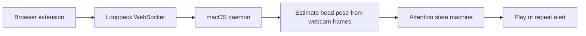
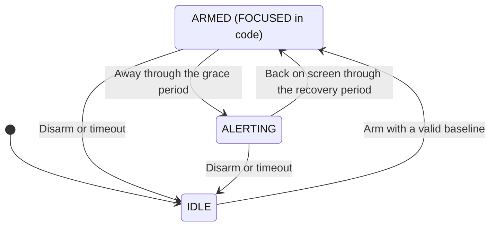

# LockIn

Stop doom-scrolling while your AI thinks.

[](LICENSE)


You send a prompt to Claude or ChatGPT, the answer takes a while, and you end up on your phone. LockIn uses your webcam to estimate where your head is facing while the AI generates a response. If you look away long enough, it repeats an audible alert until you look back or the session ends.

<!-- DEMO: docs/demo.gif -->
Demo coming soon

## Table of contents

- [How it works](#how-it-works)
- [Features](#features)
- [Quick start for macOS](#quick-start-for-macos)
- [Usage](#usage)
- [Configuration](#configuration)
- [Privacy and security](#privacy-and-security)
- [Supported browsers and sites](#supported-browsers-and-sites)
- [Troubleshooting](#troubleshooting)
- [Limitations](#limitations)
- [Project structure](#project-structure)
- [Roadmap](#roadmap)
- [Contributing](#contributing)
- [License](#license)
- [Acknowledgments](#acknowledgments)

## How it works



The menu bar calls the monitoring state **ARMED**. In the code it is named `FOCUSED`. Both that state and `ALERTING` are armed states.



See [architecture and WebSocket protocol](docs/architecture.md) for the component details.

## Features

- macOS menu bar controls and a separate debug webcam preview.
- Head-pose calibration with up to three automatic retries and three sensitivity presets.
- Automatic arming and disarming when supported AI tabs start and finish generating.
- Configurable global shortcut and selectable alert sounds with previews.
- Local session totals, a reset control, and optional launch at login.
- Generation detection for Claude, ChatGPT, and Gemini, with selector verification status listed below.

## Quick start for macOS

Run the following from the repository root. The Intel Mac setup uses Python 3.12 and prebuilt wheels. No compiler, Xcode, or Xcode Command Line Tools are needed. LockIn bundles a rumps wheel because upstream publishes rumps as source.

**Do not paste the whole setup block twice.** If a command fails, fix the error and resume at that command.

```sh
curl -LsSf https://astral.sh/uv/install.sh | sh
export PATH="$HOME/.local/bin:$PATH"
uv venv --python 3.12
uv pip install -r requirements.txt --only-binary :all:
curl --fail --location \
  https://storage.googleapis.com/mediapipe-models/face_landmarker/face_landmarker/float16/1/face_landmarker.task \
  --output daemon/face_landmarker.task
./run.sh
```

Allow camera access when prompted. Sit in your normal working position and look at the screen throughout calibration. On later launches, run only `./run.sh`.

For browser automation, open `chrome://extensions` (or your browser's extensions page), enable **Developer mode**, and choose **Load unpacked**. Select the repository's `extension/` folder, then reload any open AI tabs. Check for **Connected** in the toolbar popup. [Extension installation and troubleshooting](extension/README.md)

## Usage

| Menu item | What it does |
| --- | --- |
| **Arm / Disarm** | Starts or ends monitoring and displays the configured shortcut. Requires a saved baseline. |
| **Recalibrate** | Pauses monitoring and records a fresh baseline. The menu bar counts down, ticks each second, and plays a confirmation after saving. |
| **Sensitivity** | Scales the yaw and pitch thresholds and grace period by 1.25× on Low, 1× on Medium, and 0.75× on High. |
| **Alert sound** | Previews the selected audio file from `assets/` and saves it as the alert sound. Restart to pick up newly added files. |
| **Extension** | Shows whether a browser extension is connected. |
| **Today** | Shows session count, focus percentage, and alert count, including the current session. Sessions are grouped by local start date. |
| **Reset stats** | Clears saved sessions and restarts counting for an active session. |
| **Launch at login** | Installs or removes a user LaunchAgent for this checkout's `run.sh`. macOS may ask for camera permission again for the process that launches it. If you move the checkout, toggle the setting off and on there. |
| **Open config.json** | Opens the saved settings in your default editor. |
| **Quit** | Stops playback and releases the camera. |

- **IDLE** means attention alerts are off. The daemon still processes webcam frames while running.
- **ARMED** means monitoring is active. This includes the grace period before an alert.
- **ALERTING** means the away condition has lasted through the grace period. The alert repeats until you look back for the recovery period or the session ends.

Press **Control + Option + L** to toggle manually. Browser automation arms when the first tab becomes busy and disarms extension-owned sessions when the last busy tab goes idle or disconnects. Manual disarm suppresses auto-arming until a new group of busy tabs. Manual sessions time out after five minutes by default. Extension-owned sessions time out after 20 minutes.

Keep your face visible for the full calibration window. If you recalibrate from the menu, arm again when ready. For a video preview, run `.venv/bin/python -m daemon.vision --debug` separately from menu bar mode. Press **Q** or **Esc** in the preview to quit. Add `--always-armed` for testing without the hotkey or automatic timeout.

## Configuration

The first successful calibration writes `config.json` in the repository root. Edit it and restart LockIn to apply manual changes. The menu saves sensitivity and sound changes directly.

| Key | Default | Meaning |
| --- | --- | --- |
| `baseline_yaw` | `null` | Calibrated left/right head angle in degrees. |
| `baseline_pitch` | `null` | Calibrated up/down head angle in degrees. |
| `yaw_threshold` | `28.0` | Degrees left or right of the baseline before counting as away. |
| `pitch_threshold` | `20.0` | Degrees downward from the baseline before counting as away. |
| `missing_seconds` | `2.0` | Time without a detected face before counting as away. |
| `grace_seconds` | `3.0` | Continuous time away before entering `ALERTING`. |
| `recovery_seconds` | `1.0` | Continuous time back on screen before leaving `ALERTING`. |
| `repeat_seconds` | `5.0` | Interval between repeats while alerting. Playback does not overlap. |
| `calibration_seconds` | `3.0` | Continuous valid face-pose sampling time per attempt. |
| `smoothing_frames` | `5` | Number of recent angle samples averaged. |
| `hotkey` | `<ctrl>+<alt>+l` | Global arm/disarm shortcut in pynput syntax. |
| `armed_timeout_seconds` | `300.0` | Maximum duration of a manually armed session. |
| `websocket_port` | `8765` | Loopback port. Set the extension popup to the same value. |
| `extension_timeout_seconds` | `1200.0` | Maximum duration of an extension-owned session. |
| `sensitivity` | `"Medium"` | Preset that scales yaw, pitch, and the grace period. |
| `alert_sound` | `"alert.wav"` | Filename of the alert sound in `assets/`. |

## Privacy and security

- Webcam frames are processed in memory. LockIn never saves or transmits them.
- The extension checks generation controls using button selectors, accessibility labels, and visibility. It never reads conversation text. Generation messages send only state, site hostname, and tab ID. The extension also sends a heartbeat.
- The WebSocket server binds only to `127.0.0.1` and requires exactly one `Origin` header beginning with `chrome-extension://`.
- Local `stats.json` stores session start time, duration, seconds in `FOCUSED` and `ALERTING`, and the number of entries into `ALERTING`. It contains no images.

## Supported browsers and sites

Works in Chromium browsers (Chrome, Arc, Edge, Brave). Safari is unsupported. The extension manifest requires Chrome 116 or newer.

| Site | Selector status |
| --- | --- |
| Claude (`claude.ai`) | Fixture-tested. Live signed-in page unverified. |
| ChatGPT (`chatgpt.com`) | Fixture-tested. Live signed-in page unverified. |
| ChatGPT legacy hostname (`chat.openai.com`) | Fixture-tested. Live signed-in page unverified. |
| Gemini (`gemini.google.com`) | Fixture-tested. Live signed-in page unverified. |

## Troubleshooting

<details>
<summary>Camera access needed</summary>

In **System Settings → Privacy & Security → Camera**, enable access for Terminal or the app that launches LockIn. Restart the launcher and LockIn. If the launcher is missing from the list, run LockIn from it to trigger the prompt.

</details>

<details>
<summary>The global hotkey does not work</summary>

Enable both **Input Monitoring** and **Accessibility** for the launcher in **System Settings → Privacy & Security**, then restart it and LockIn. Use **Arm / Disarm** in the menu bar, or **Space** in the focused debug window when the hotkey is unavailable.

</details>

<details>
<summary>The extension shows Not connected</summary>

Start LockIn and confirm browser automation is enabled in the popup. Match the popup port to `websocket_port` in `config.json` (normally `8765`). Restart LockIn after editing the file. Check Terminal for server errors.

</details>

<details>
<summary>The extension is connected, but LockIn never arms</summary>

Calibrate first, reload the AI tab after installing the extension, and look for a busy tab in the popup while a response is generating. If the site changed its Stop button, update its selectors in `extension/sites.js` and reload the extension and tab. [Selector troubleshooting](extension/README.md#troubleshooting)

</details>

<details>
<summary>Calibration fails</summary>

Sit in your normal working position with your face centered and well lit. Look at the screen for the entire countdown. LockIn restarts the attempt if it loses your face and retries up to three times. Choose **Recalibrate** to try again after the retries run out.

</details>

<details>
<summary>Intel Mac installation asks for Xcode or fails to find a wheel</summary>

Use the Python 3.12 environment and the exact wheel-only install command above, from the repository root. Confirm the checkout includes the bundled wheel in `vendor/`. If the resolver still reports an incompatible wheel, include the macOS version, CPU architecture, and resolver output when reporting it.

</details>

## Limitations

- Head pose cannot distinguish a glance at a phone from a glance at the keyboard.
- The supported desktop app runs on macOS.
- Browser automation depends on site button selectors, which can break when sites change.

## Project structure

| Path | Purpose |
| --- | --- |
| `daemon/` | Python application and local services. |
| `daemon/vision.py` | CLI, webcam loop, calibration, and integration. |
| `daemon/state.py` | Configuration defaults and attention state machine. |
| `daemon/alert.py` | Non-overlapping alert and cue playback. |
| `daemon/hotkey.py` | Global shortcut and availability checks. |
| `daemon/menubar.py` | macOS menu bar UI and worker coordination. |
| `daemon/server.py` | Loopback WebSocket server and connection tracking. |
| `daemon/stats.py` | Local armed-session totals. |
| `daemon/login.py` | User LaunchAgent installation and removal. |
| `extension/` | Unpacked Manifest V3 browser extension. |
| `extension/manifest.json` | Permissions, host matches, and entry points. |
| `extension/sites.js` | Supported hostnames and generation selectors. |
| `extension/content.js` | Generation control detection. |
| `extension/background.js` | Busy-tab tracking and WebSocket connection. |
| `extension/popup.html` | Toolbar popup markup. |
| `extension/popup.js` | Popup status and settings controls. |
| `extension/popup.css` | Toolbar popup styling. |
| `extension/README.md` | Extension installation and selector troubleshooting. |
| `assets/` | Bundled alert, calibration, and mode-change sounds. |
| `docs/` | Architecture notes and the future demo destination. |
| `docs/.gitkeep` | Directory marker for the future demo. |
| `docs/architecture.md` | Daemon, extension, and protocol reference. |
| `vendor/` | Prebuilt rumps wheel and its sourcing notes. |
| `vendor/README.md` | Bundled wheel provenance and verification steps. |
| `README.md` | Project overview and usage guide. |
| `requirements.txt` | Python dependencies for wheel-only setup. |
| `run.sh` | Activates the virtual environment and starts menu bar mode. |
| `CHANGELOG.md` | Project milestone history. |
| `SECURITY.md` | Security model and reporting instructions. |
| `LICENSE` | MIT license text. |
| `.gitignore` | Keeps machine-local files and caches out of Git. |
| `AGENTS.md` | Branch and pull request workflow. |

## Roadmap

These ideas are for future releases.

- Detect generation in the Claude desktop app.
- Detect phones directly.
- Add more supported sites.

## Contributing

Open an issue with the behavior, environment, and steps to reproduce. For changes, use a feature branch and open a pull request against the default branch. Include the site and button attributes when proposing a selector update.

## License

LockIn is MIT-licensed. Bundled third-party software retains its own license. [MIT license](LICENSE) · [Bundled wheel details](vendor/README.md)

## Acknowledgments

LockIn uses MediaPipe Face Landmarker for pose estimation and OpenCV for camera capture and the debug preview. [MediaPipe](https://github.com/google-ai-edge/mediapipe) · [OpenCV](https://opencv.org/)
